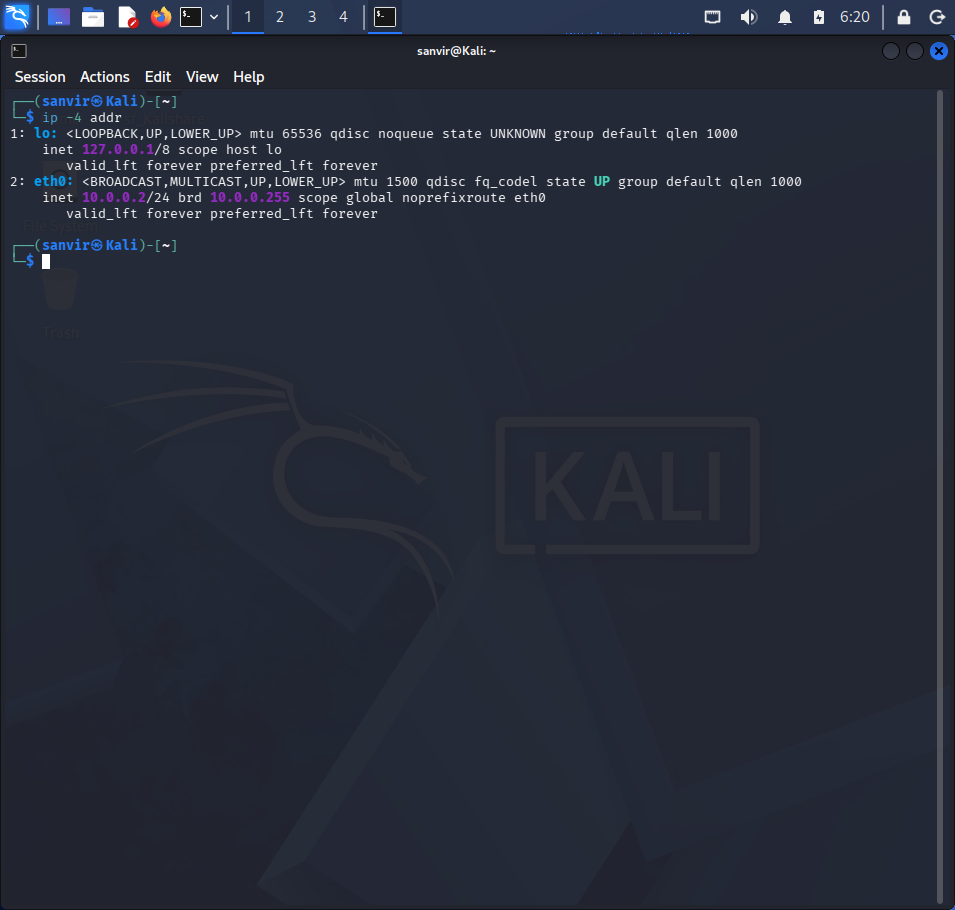
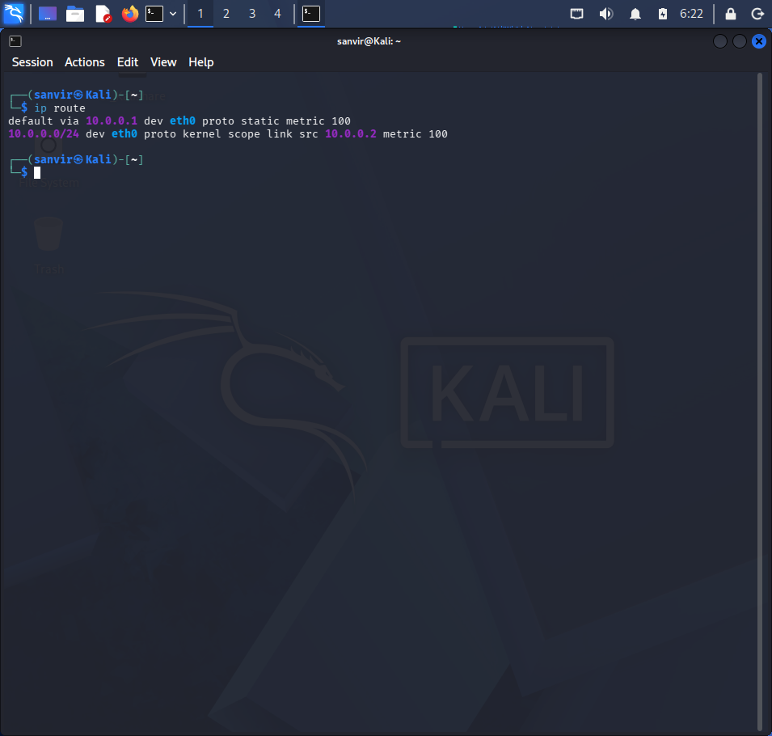
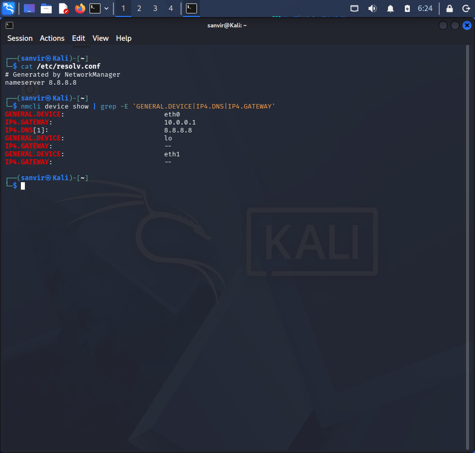
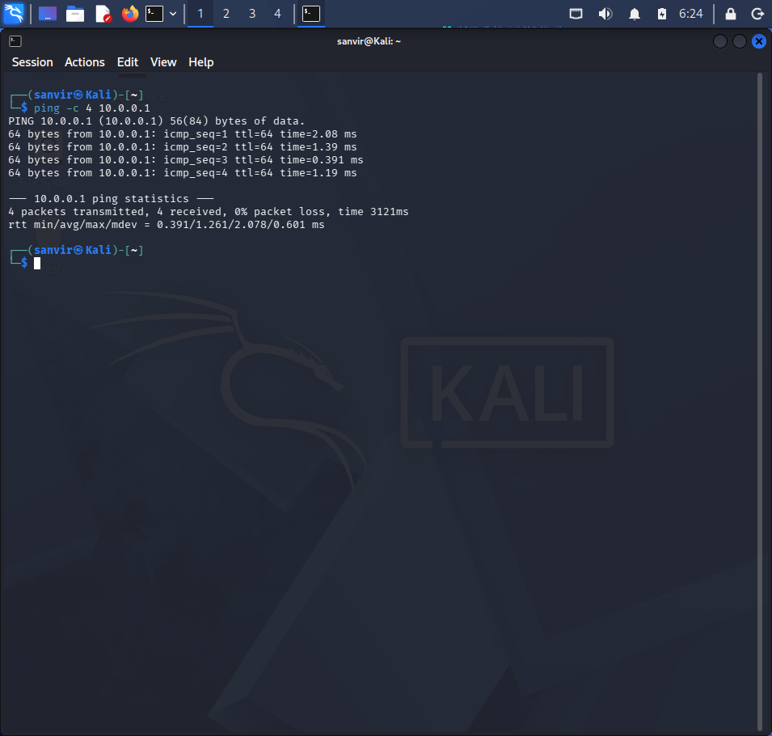
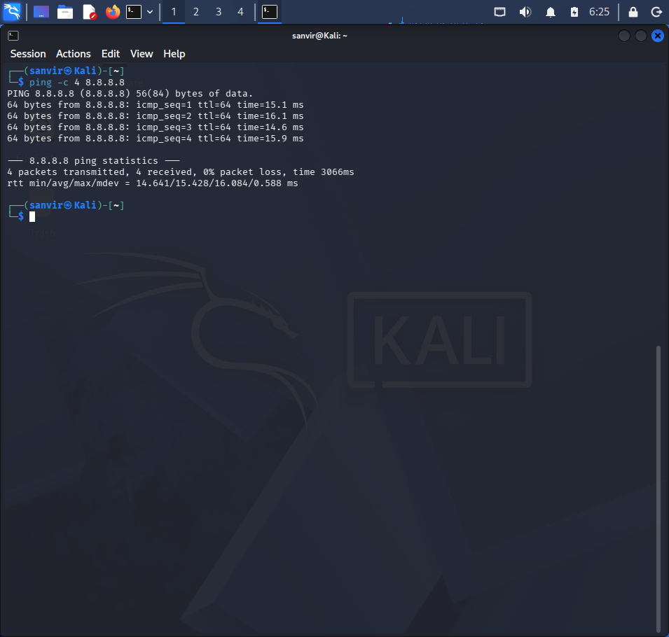
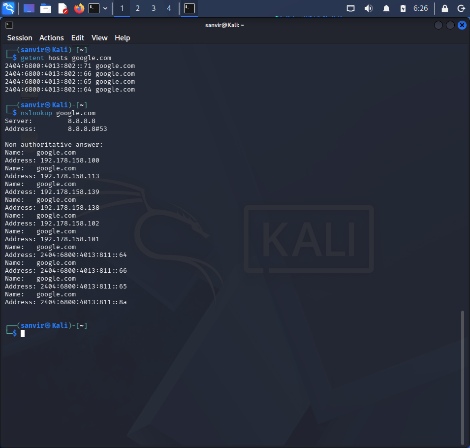
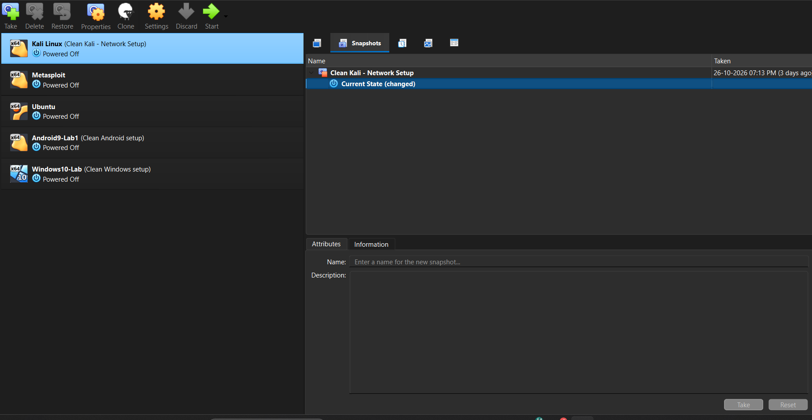
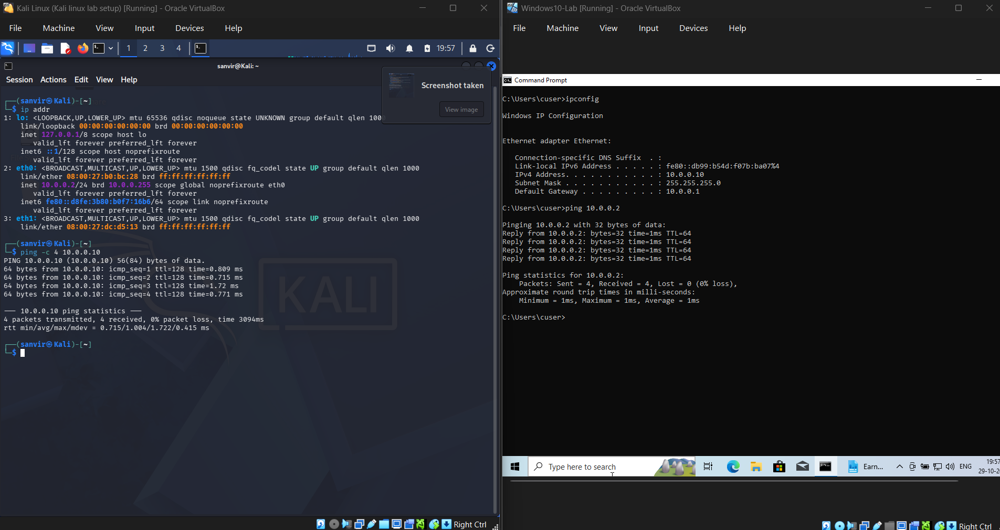
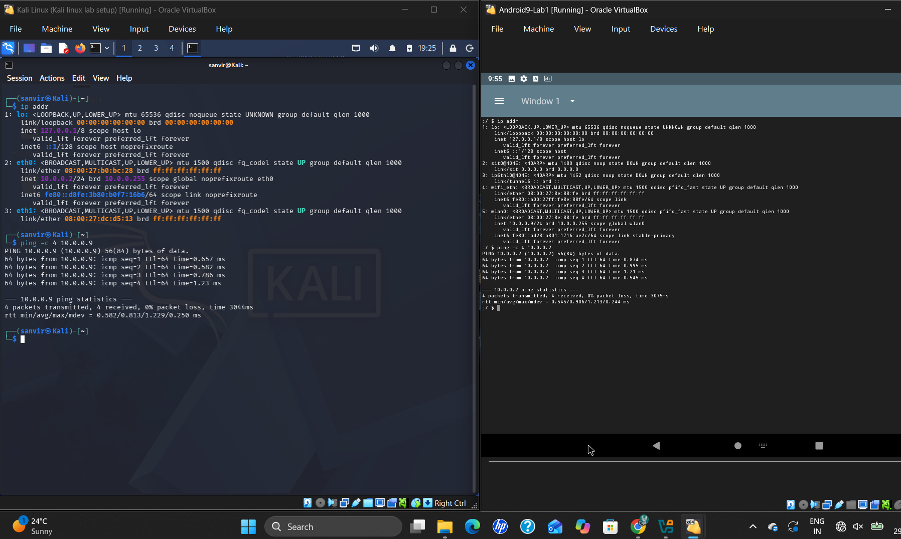

# 🛡️ NetworkWalks Cybersecurity Lab Setup


## 📌 Project Overview

This repository documents my cybersecurity lab environment as part of the NetworkWalks cybersecurity lab assignment.

Kali Linux was already installed on my system before the assignment. I reviewed and configured the relevant network settings and performed connectivity tests to verify the lab environment.

The repository contains system information, network configuration details, connectivity test results, screenshots, and troubleshooting notes.

## 🎯 Objectives

- Document the existing Kali Linux environment.
- Identify the active network interface.
- Inspect IPv4 addressing and subnet configuration.
- Identify the default gateway and routing table.
- Review DNS configuration and test domain resolution.
- Verify gateway and external IP connectivity.
- Document the results using terminal screenshots.
- Develop practical Linux networking and troubleshooting skills.
- Prepare the environment for future cybersecurity projects.

## 🛡️ Purpose of the Lab

This lab provides an isolated and controlled environment for cybersecurity learning, hands-on experimentation, and authorized security testing.

It is designed to support practical learning activities such as:

- 🔎 **Network Reconnaissance:** Identifying hosts and understanding network services.
- 🎯 **Port Scanning:** Discovering open ports and running services using tools such as Nmap.
- 🛠️ **Vulnerability Assessment:** Learning how to identify and evaluate potential security weaknesses.
- 📡 **Packet Analysis:** Inspecting network traffic to understand communication protocols.
- 🌐 **Web Security Testing:** Practising web application security techniques in authorized lab environments.
- 🧪 **Exploitation Practice:** Understanding vulnerabilities and exploitation techniques in deliberately vulnerable, controlled environments.
- ⚙️ **Security Tool Experimentation:** Exploring cybersecurity tools and learning their practical applications.

### ⚠️ Ethical and Responsible Use

This laboratory is intended strictly for educational purposes and authorized security testing.

- Test only systems you own or have explicit permission to assess.
- Perform security testing within the intended lab environment.
- Do not scan, exploit, or attack unauthorized systems.
- Follow applicable laws, institutional policies, and responsible disclosure practices.

**The objective of this lab is to develop practical cybersecurity skills while maintaining a responsible and ethical approach to security testing.**

## 💻 Lab Environment

### Host System and Virtualization

| Component | Specification |
|---|---|
| 🖥️ Host Operating System | Windows 11 |
| 🧠 Host RAM | 16 GB |
| ⚡ Processor | Intel Core 5 120U |
| 🧰 Hypervisor | Oracle VirtualBox 7.2.12 |
| 🐉 Guest Operating System | Kali Linux 2026.3 |
| 🧠 Allocated Kali RAM | 4096 MB (4 GB) |
| 🌐 Virtual Network Mode | NAT Network |

### Initial Kali Network Settings

| Component | Configuration |
|---|---|
| 📡 Network Address | `10.0.0.0/24` |
| 🐧 Kali Linux IPv4 Address | `10.0.0.2/24` |
| 🚪 Default Gateway | `10.0.0.1` |
| 🌍 DNS Server | `8.8.8.8` |
| 🔮 Planned VM Address Range | `10.0.0.3–10.0.0.99` |

## 🌐 Network Configuration

The following commands were used to inspect the network configuration.

### 1. Network Interface and IP Address

```bash
ip -br addr
ip -4 addr
```

These commands display the network interfaces and their IPv4 addresses.

**Result:** To be documented using the actual terminal output.



### 2. Routing Table

```bash
ip route
```

This command displays the routing table, including the default route when one is configured.



### 3. DNS Configuration

```bash
cat /etc/resolv.conf
```

This command displays the resolver configuration available to applications.

```bash
nmcli device show
```

This command provides additional network device information when NetworkManager is available.



## 🧪 Connectivity Tests

### 1. Default Gateway Test

```bash
ping -c 4 <gateway-ip>
```

Replace `<gateway-ip>` with the actual default gateway address.

**Purpose:** To test whether the gateway responds to ICMP requests.



### 2. External IP Connectivity Test

```bash
ping -c 4 8.8.8.8
```

**Purpose:** To test connectivity to an external IP address using ICMP.



### 3. DNS Resolution Test

```bash
getent hosts google.com
```

**Purpose:** To check whether the system can resolve a domain name.



## 📸 Clean VM Snapshot

A VirtualBox snapshot was created after the initial Kali Linux configuration.

**Snapshot Name:** `Clean Kali - Network Setup`

This snapshot serves as a clean baseline, allowing the VM to be restored if future lab exercises affect its configuration.

  
## 🖥️ Extended Virtual Lab Environment

As an extension of the initial Kali Linux setup, Windows 10 and Android virtual machines were installed in VirtualBox and connected to the same NAT Network.

### Virtual Machines

| Virtual Machine | Purpose | Network |
|---|---|---|
| Kali Linux | Security testing and network analysis | NAT Network |
| Windows 10 | Target machine for connectivity and security testing | NAT Network |
| Android | Mobile environment for connectivity testing | NAT Network |

### Objectives

- Configure all three VMs on the same virtual network.
- Verify IP address assignments.
- Test connectivity between virtual machines.
- Build a multi-OS environment for future cybersecurity labs.
  
## 🔧 Troubleshooting

### 1. DNS Configuration
- **Issue:** DNS queries to `10.0.0.1` were unsuccessful.
- **Solution:** Configured Google Public DNS (`8.8.8.8`) and verified DNS resolution.

### 2. Windows 10 Connectivity
- **Issue:** Kali Linux could not ping the Windows 10 VM.
- **Troubleshooting:** Checked the NAT Network configuration, IP addresses, and Windows Firewall settings.

### 3. Android Network Configuration
- **Issue:** Required network configuration and connectivity verification.
- **Solution:** Configured the Android VM to use the same NAT Network and checked its IP settings.

## 🖥️ VM Connectivity Details

All three virtual machines are connected to the same VirtualBox NAT Network.

| Configuration | Kali Linux | Windows 10 | Android |
|---|---|---|---|
| Operating System | Kali Linux 2026.3 | Windows 10 | Android-x86 |
| Network Mode | NAT Network | NAT Network | NAT Network |
| Network Address | `10.0.0.0/24` | `10.0.0.0/24` | `10.0.0.0/24` |
| IPv4 Address | `10.0.0.2` | `10.0.0.10` | `10.0.0.9` |
| Default Gateway | `10.0.0.1` | `10.0.0.1` | `10.0.0.1` |
| DNS Server | `8.8.8.8` | `8.8.8.8` | `8.8.8.8` |

### Key Learning
Verified that correct network configuration, DNS settings, and firewall rules are essential for communication between virtual machines.

### Screenshots
screenshots showing the network configuration and connectivity tests for each VM.



## 🎯 Learning Outcomes

- **Virtualization:** Installed and managed multiple operating systems using VirtualBox.
- **Network Configuration:** Configured a shared NAT Network for Kali Linux, Windows 10, and Android VMs.
- **IP Addressing:** Learned IP configuration, default gateways, and DNS settings.
- **Connectivity Testing:** Practiced testing network connectivity between virtual machines.
- **Troubleshooting:** Identified and resolved network configuration and DNS issues.
- **Snapshot Management:** Created a clean VM snapshot for recovery and safe experimentation.
- **Cybersecurity Lab Setup:** Built a multi-OS environment for future network scanning, traffic analysis, and security testing.
- **Documentation:** Documented configurations, troubleshooting steps, and test results using GitHub.


## 👤 Author

**GitHub:** [14mSana](https://github.com/14mSana)
